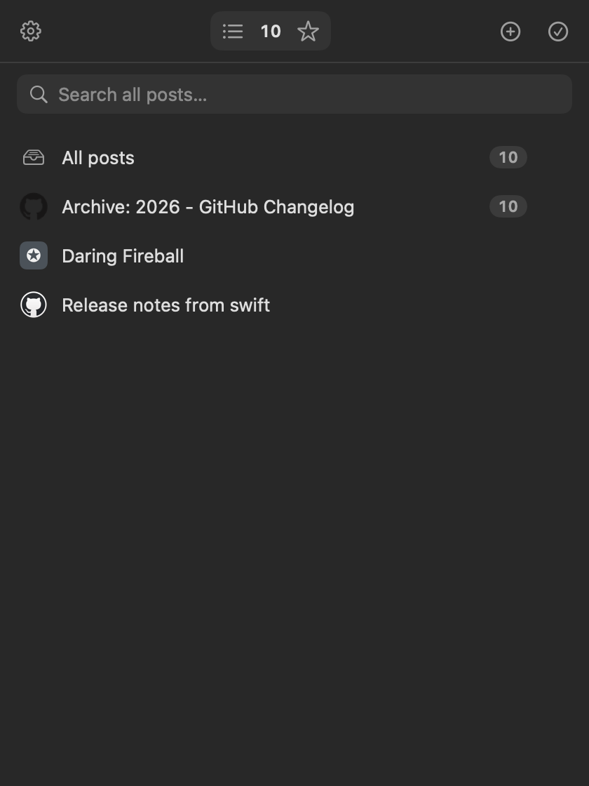
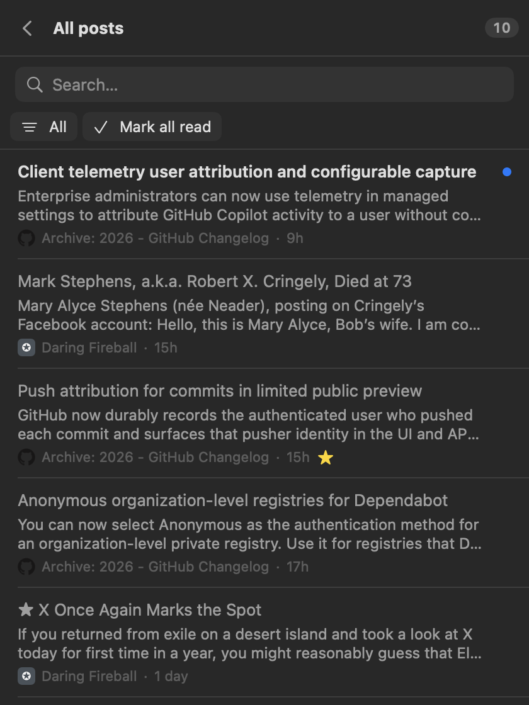
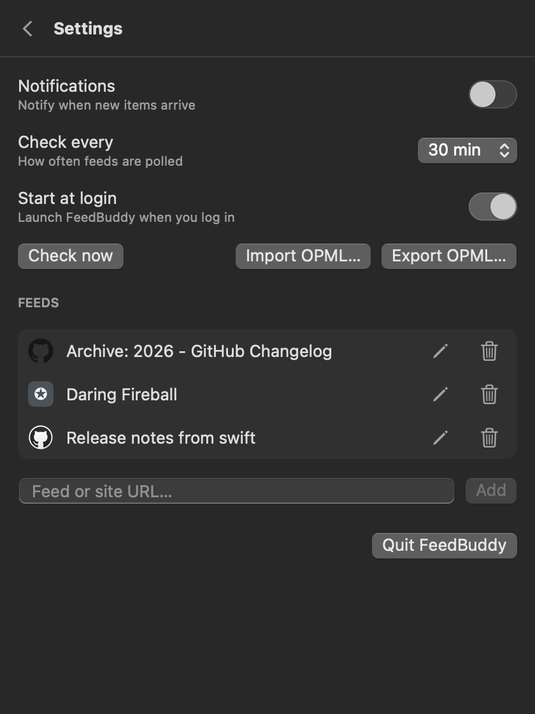

# FeedBuddy

A private RSS/Atom reader that lives in your macOS menu bar. No accounts, no servers,
no telemetry. It polls your feeds on a schedule, shows the unread count next to the
menu bar icon, and lets you read, search, star, and mark items read. All data lives in
one file on your Mac.

The menu bar sibling of the [FeedWatch](https://github.com/adriano-kaiser/feedwatch) Chrome extension.

<p>
  
  
  
</p>

## Install

1. Download `FeedBuddy.zip` from the [latest release](https://github.com/adriano-kaiser/feedbuddy/releases/latest) and unzip it.
2. Move `FeedBuddy.app` to `/Applications` (or `~/Applications`).
3. The app is not notarized, so macOS blocks the first launch. Either allow it under
   **System Settings → Privacy & Security → Open Anyway**, or remove the quarantine flag:

   ```bash
   xattr -dr com.apple.quarantine /Applications/FeedBuddy.app
   ```

Requires macOS 14 or later. Runs on Apple Silicon and Intel.

## Add feeds

Click **+** (or open Settings) and paste either:

- a direct feed URL (RSS 2.0, RSS 1.0 or Atom), or
- a normal site URL. FeedBuddy finds the feed via the page's
  `<link rel="alternate" type="application/rss+xml">`.

Moving from another reader? Use **Import OPML…** in Settings. **Export OPML…** writes
your subscriptions back out.

## What it does

- **Polling** every 15/30/60/120 minutes (default 30), plus a check when you open the
  dropdown and after your Mac wakes up.
- **Unread count in the menu bar** next to the icon; just the icon when everything is read.
- **History backfill.** Most feeds only return the latest ~10 items. When a feed is new or
  sparse, FeedBuddy pulls older pages (`rel="next"`, `?paged=N` or `/page/N/`) so you get a
  fuller list right away. Scrolling to the bottom of a feed loads older posts from the source.
  Kept up to 200 read items per feed; unread and starred items are never pruned.
- **Adding a feed doesn't flood you.** Its existing archive is imported as read; only
  posts that show up later count as unread.
- **Stable order.** Posts keep their place; a refresh only adds new ones.
- **Feed icons** from the feed itself, falling back to the site's favicon, then to a
  colored letter.
- **Per-feed view** with unread counts and an All / Unread / Starred filter.
- **Search** across titles and summaries.
- **Star**, **mark read/unread**, **mark all read** (one feed or everything).
- **Per-feed menu** (hover ⋯ or right-click): mark feed as read, open all unread, reload,
  edit title/URL, delete.
- Optional **notifications** when new items arrive (off by default).
- **Start at login** (on by default, toggle in Settings).

## Why you can trust it

- The only network requests go to the feeds you add and their sites (for icons). No
  analytics, no third party. `FeedService.swift` holds all feed fetching.
- Data is stored in `~/Library/Application Support/FeedBuddy/data.json`. Nothing is synced
  or uploaded.
- Feed content is shown as plain text, never rendered as HTML.

## Build from source

Needs the Xcode Command Line Tools (full Xcode is not required).

```bash
./build.sh            # builds build/FeedBuddy.app
./build.sh install    # also copies it to ~/Applications and launches it
```

Two developer aids are built in:

```bash
# Add one feed into a throwaway store and print what was parsed, paged and merged
.build/release/FeedBuddy --check https://github.blog/changelog/feed/

# Render every screen (light + dark) to PNGs using the data in a folder
.build/release/FeedBuddy --snapshot ./shots --data ~/Library/Application\ Support/FeedBuddy
```

The app icon is drawn by `scripts/make-icon.swift`.

## Releasing

Push a version tag; GitHub Actions builds a universal app and attaches it to a release.

```bash
git tag v1.1.0 && git push origin v1.1.0
```

See [CHANGELOG.md](CHANGELOG.md) for release notes.

## License

[MIT](LICENSE)
